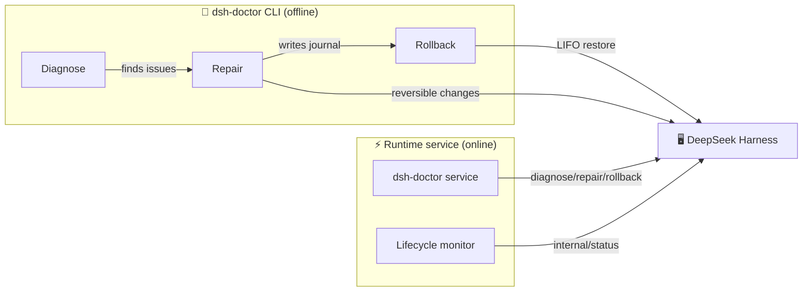

<div align="center">

# 🩺 dsh-doctor

### Your personal doctor for DeepSeek Harness

**Diagnose · Reversible Repair · One-click Rollback · Runtime Self-healing**

[](https://github.com/BeckChiang/dsh-doctor)
[](https://github.com/jorinyang/dsh-doctor)
[](LICENSE)

**中文** · [README.md](./README.md)

</div>

---

> **This repository is a fork of [@jorinyang/dsh-doctor](https://github.com/jorinyang/dsh-doctor)** (MIT, upstream 0.3.2 / `79418687`).
> The engine, the three model tools, the Cordis runtime service and the CLI are kept as-is. The fork adds one layer on top of
> `lib/index.js`: a **settings panel ("体检" / check-up) with a five-rung repair ladder** (see "Check-up panel" below and
> [DESIGN.md](./DESIGN.md)). The npm package `@jorinyang/dsh-doctor` is still the upstream one; this fork is published as
> `@beckchiang/dsh-doctor` and is not on npm yet.

---

> **DSH crashed? Can't start?**
>
> Two commands to catch your emotions and fix the root cause.

```bash
# ① Install
dsh plugin --profile web add @jorinyang/dsh-doctor

# ② Fix
dsh-doctor
```

**Built-in CLI, auto-registered to system PATH on install. Repairs are fully reversible — roll back anytime.**

---

## 💡 What it is

DeepSeek Harness ships no built-in `doctor` command. When DSH crashes, fails to start, or a plugin breaks the profile, you're left staring at errors and hoping a restart will help.

**dsh-doctor** is the first all-in-one "diagnose + repair + rollback" tool for DSH, and it's also a **runtime self-healing service**:

| Capability | Form | Description |
|-----------|------|-------------|
| 🔍 **Diagnose** | `dsh_doctor` tool / `dsh-doctor` CLI | Read-only 9-category checks |
| 🔧 **Repair** | `dsh_doctor_fix` tool / `dsh-doctor fix` | Graded repair, every reversible change journaled |
| ↩️ **Rollback** | `dsh_doctor_rollback` tool / `dsh-doctor rollback` | LIFO undo to the pre-repair state |
| ⚡ **Runtime service** | `dsh-doctor` Cordis service | Live diagnose/self-heal/lifecycle monitoring |

---

## ✨ Why dsh-doctor

### 🎯 Two commands to revive a crashed DSH

No need to read error logs or hand-edit configs:

```bash
dsh-doctor          # diagnose first
dsh-doctor fix      # then repair
```

### ↩️ Reversible repairs — safe to fix

Every fix writes a **journal** recording the undo step of each change. Broke something? One command to undo:

```bash
dsh-doctor rollback              # undo the most recent repair
dsh-doctor rollback --list       # list all journals
dsh-doctor rollback --id <id>    # undo a specific journal
```

### ⚡ Runtime self-healing — works while DSH is alive

Not just stop-and-fix. dsh-doctor wires into Cordis's native runtime:

- `ctx.provide('dsh-doctor')` — expose diagnose/repair/rollback to other plugins
- `ctx.on('internal/status')` — reactive plugin-lifecycle monitoring with FAILED alerts
- `ctx.effect()` — reversible effects, no residue on unload

### 🌍 Cross-platform, zero config

Auto-registers to system PATH on install — Windows / macOS / Linux / fish.

---

## 🩺 Check-up panel (added by this fork)

The upstream package is tools + CLI + a runtime service. This fork puts a **settings panel** on top of the
same engine, so "diagnose → repair → roll back → hand off" is one visible path. The panel never re-derives
anything: it calls the very `DoctorService` this plugin provides as `dsh-doctor`.

### Five-rung ladder

| Rung | What happens | Default |
|------|--------------|---------|
| **L0 observe** | read-only `diagnose`; every finding gets a stable `code` | always on |
| **L1 self-fix** | `scope=safe` only (create missing dirs/files, fix the allowBuilds placeholder), every step journaled | one click; `autoSafe` is off |
| **L2 graded repair** | `deps` (+ `pnpm install --fix-lockfile`) / `full` (+ stop leftover processes) | both need explicit confirmation; `full` is irreversible |
| **L3 hand off to an agent** | produce paste-ready structured context (code / evidence / profile / what was tried) — **never** opens or feeds a session | `handoff` on, deduped per code for 30 min |
| **L4 manual / ignore** | ignore a `code` until you un-ignore it | reversible anytime |

Each finding carries an honest fixability verdict: 🟢 `auto` (safe really mutates it), 🟡 `confirm` (only a higher scope
touches it), 🔵 `handoff` (the engine does not touch it at all — e.g. a missing `package.json`), ⚪ `info` (not a problem).
The panel never offers a "fix" button for something the engine cannot fix.

### Panel sections

1. **Status bar** — last run, target profile/port, health counts, whether the service is ready
2. **Findings** — severity colour, `code`, verbatim evidence, upstream `fixHint`, fixability badge, and fix / hand off / ignore
3. **Ledger** — every journal with its undo steps; "needs manual compensation" is marked separately (a lockfile change is
   never reported as "rolled back")
4. **Ladder policy** — `autoSafe` / `confirmDeps` / `confirmFull` / `handoff` switches and whether `info` findings show

### HTTP surface

Mounted under `/api/dsh-doctor/*` (panel header `x-dsh-doctor: 1` required):
`state`, `diagnose`, `fix` (202 jobId), `job?id=`, `journals`, `journal?id=`, `rollback`, `ladder` (GET/POST),
`ignore`, `handoff`. Repair runs as a one-at-a-time background job because `pnpm install` can take minutes.
State lives in `<DSH_HOME>/storages/dsh-doctor/state.json` (atomic temp-file + rename).

The web server stays optional: `inject` is still just `tools`, and the panel mounts through
`ctx.inject(['webServer'], …)`. A headless runtime keeps the tools, the service and the CLI — just no panel.

### Install this fork

```bash
git clone https://github.com/BeckChiang/dsh-doctor.git
dsh plugin --profile web add /absolute/path/to/dsh-doctor
```

Restart DSH and a "体检" section appears in Settings.

### Known limits

- `full` cannot list PIDs: upstream `stopDshProcesses()` returns no process details, so the panel can only warn that
  processes will be stopped.
- Upstream exposes no stable check ids, so `code` is derived from `kind` + `detail` wording. If upstream rewords a
  check, the finding degrades to "unrecognised → handoff", never to "auto-fixable".
- The panel is orchestration only: no model picker, no API keys, no client scanning.

---

## 🚀 Quick start

### Option A: DSH plugin (for the agent)

```bash
# install from npm
dsh plugin --profile web add @jorinyang/dsh-doctor

# restart dsh web
dsh web
```

Then ask the agent:

```text
run dsh_doctor                     # diagnose
run dsh_doctor_fix with scope safe # repair
run dsh_doctor_rollback            # rollback if needed
```

### Option B: global CLI

```bash
npm install -g @jorinyang/dsh-doctor
# or
npx @jorinyang/dsh-doctor
```

### Demo

```bash
$ dsh-doctor diagnose --profile web

DSH Diagnostic Report  (profile: web, port: 3080)
DSH home: ~/.dsh

  [OK]   Node.js v24.15.0
  [OK]   pnpm 11.9.0
  [OK]   DSH 0.1.0-rc.6
  [OK]   DSH home exists
  [OK]   profile dir exists: web
  ...
  [XX]   bundle missing: some-broken-plugin
         fix: Run pnpm install in profile dir

  48 pass  0 fail  3 warn
  ✓ No blocking issues found; DSH should start normally.
```

---

## 📖 Command reference

| Command | Description | Alias |
|---------|-------------|-------|
| `dsh-doctor` | Read-only diagnose (default) | `diagnose` / `check` |
| `dsh-doctor fix` | Reversible repair | `repair` |
| `dsh-doctor rollback` | LIFO undo | `undo` |
| `dsh-doctor rollback --list` | List journals | `journals` / `list` |
| `dsh-doctor setup` | Register to PATH | `install` / `register` |

### Options

| Option | Description | Default |
|--------|-------------|---------|
| `--profile <name>` | DSH profile name | `web` |
| `--port <number>` | Web port | `3080` |
| `--scope <level>` | safe / deps / full | `safe` |
| `--id <id>` | Journal id to roll back | most recent |
| `-h, --help` | Help | |
| `-V, --version` | Version | |

### Repair scopes

| Scope | Actions | Risk |
|-------|---------|------|
| `safe` ⭐ | create missing dirs/files; fix allowBuilds | 🟢 Low — files/config |
| `deps` | safe + `pnpm install --fix-lockfile` | 🟡 Medium — network + deps |
| `full` | deps + stop residual processes (skip if healthy) | 🔴 Higher — process kill |

---

## 🏗️ How it works

dsh-doctor aligns with DeepSeek Harness / Cordis's **Spatiotemporal Composability** paradigm:



### Temporal — reversible repairs

Every change records a **reverse undo function**; rollback replays LIFO:

- overwritten file → original saved, restored on rollback
- created file/dir → deleted on rollback (empty dirs only)
- system-boundary ops (pnpm install, killed processes) → flagged manual

### Spatial — runtime self-healing

Wires into Cordis primitives to declare deps and react to changes:

- `ctx.provide` — provide services
- `ctx.on` — reactive listeners
- `ctx.effect` — reversible effects

---

## 🆚 vs. traditional approaches

| | Restart roulette | Hand-edit config | **dsh-doctor** |
|---|---|---|---|
| Diagnose | ❌ guesswork | ⚠️ experience | ✅ 9 automated checks |
| Repair | ❌ kill & retry | ⚠️ error-prone | ✅ graded auto-repair |
| Rollback | ❌ none | ❌ none | ✅ one-click LIFO |
| Runtime adjust | ❌ restart only | ❌ downtime | ✅ Cordis service |
| Cross-platform | — | — | ✅ Win/macOS/Linux/fish |

---

## ❓ FAQ

**Q: DSH is so broken the plugin can't load — still usable?**

Yes. `dsh-doctor` is a self-contained CLI that doesn't depend on DSH running. Just run `dsh-doctor fix`.

**Q: Will repair break my config?**

No. Every reversible change records an undo step first. `dsh-doctor rollback` restores it.

**Q: safe / deps / full — which to pick?**

Start with `safe` (files/config only, zero risk). Escalate to `deps` (reinstall) then `full` (process cleanup) only if needed.

**Q: Does it conflict with built-in DSH commands?**

No. It's an independent plugin + CLI; it doesn't modify DSH core.

---

## 🤝 Contributing

Issues and PRs welcome. For bug reports, please include `dsh-doctor diagnose` output.

## 📄 License

[MIT](LICENSE)

---

<div align="center">

**DeepSeek Harness, painlessly.** 🎉

If it helped you, ⭐ Star this repo!

</div>
